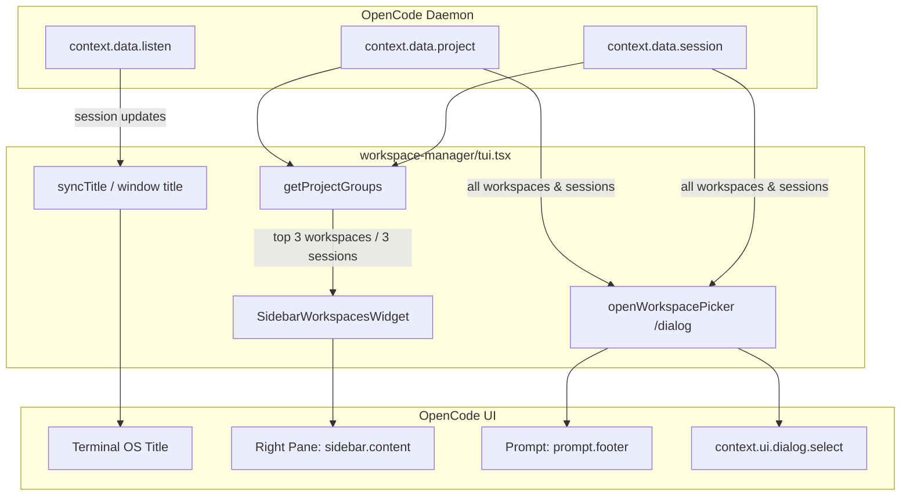

# opencode-workspace-manager

OpenCode TUI plugin for multi-workspace navigation, recency-based session tracking, and quick workspace switching.

## Overview

In multi-repository and multi-project environments, agents and sessions accumulate across directories. `workspace-manager` provides:

1. **A compact right-pane widget**: Displays the 3 most recently active workspaces and up to 3 latest sessions per workspace with colored status dots.
2. **A full workspace picker dialog**: Accessible via `/workspace` or `Ctrl+W` to browse all workspaces, inspect session states, or launch new sessions.
3. **Dynamic terminal window titles**: Formatted as `OC - <workspace> - <session title>`.
4. **Clean TUI integration**: Suppresses the redundant upper session title on the right pane so the **Workspaces** section sits flush at the top.

---

## Features

### 1. Right-Pane Sidebar Widget

Integrated into OpenCode's `sidebar.content` slot:

- **Top 3 Workspaces**: Filters and displays the 3 most recently active workspaces. The workspace for the currently active session is always prioritized to stay in view.
- **Top 3 Sessions per Workspace**: Displays up to 3 recent sessions for each workspace, sorted by recency and attention status.
- **Line-Wide Status Colors**:
  - `●` **Green** (`#a6e3a1` / theme success): Session is actively running.
  - `●` **Red** (`#f38ba8` / theme error): Session requires attention (pending question or permission request).
  - `○` **Muted / Base**: Session is idle. The active session is rendered in bold base text.
- **Click Navigation**: Click any session line in the sidebar to switch to it immediately.
- **Header Formatting**: Bold **Workspaces** header with zero blank lines before the first workspace name and clean spacing between subsequent workspaces.

### 2. Workspace Picker (`/workspace`)

Full workspace management dialog keeping all historical projects and sessions available:

- **Slash Commands**: `/workspace`, `/ws`, `/projects`
- **Keyboard Shortcut**: `Ctrl+W`
- **Footer Badge**: Clickable `📁 <workspace>` button in the prompt footer.
- **Expanded Dialog Width**: Sets the modal presentation size to `xlarge` (up to 116 columns) to prevent clipping long paths and session names.
- **Tilde Home Paths**: Replaces `$HOME` with `~` across all workspace descriptions (e.g., `~/Repositories/...`).
- **Left-Aligned Dot Status & Column Widths**: Places the dotted status indicator (`●` green / `●` red / `○` muted) at the far left edge of each line, followed by the workspace folder and name column, the full directory path (`~/...` with ~65 cols), and right-aligned session counts. The redundant state text column has been removed as the state is conveyed directly by the dot color.
- **Native Color & Background Preservation**: Uses OpenTUI native Solid `titleView` styling with `style={{ fg: ... }}` rather than raw ANSI escape sequences, preventing text-buffer truncation glitches, background color clipping, or background text bleed-through.
- **Unified Dotted Status & Color Schema**: Uses dotted status characters matching the right pane:
  - `●` **Green** (`#a6e3a1`): Running sessions / active projects.
  - `●` **Red** (`#f38ba8`): Sessions needing answers or permission approvals.
  - `○` **Muted**: Idle sessions and projects.
- **Project List**: Displays all registered daemon projects sorted by recency with wide, column-aligned layouts (`truncateTitle: false`).
- **Session Drill-Down**: Selecting a workspace opens its full session list styled with matching dotted status indicators at the left and colored titles/footers, or allows creating a new session directly at that location (`✨ Start new session in this workspace`).

### 3. Terminal Title Synchronization

Automatically updates your terminal emulator tab / window title:

```text
OC - <workspace-name> - <session-title>
```

Updates immediately on session navigation, creation, or renaming.

---

## Architecture & Design

### Component Map

```text
workspace-manager/
├── index.ts        # Server/daemon plugin entrypoint (id: workspace-manager)
├── tui.tsx         # TUI plugin: slots, keymaps, router integration, sidebar UI
└── package.json    # Plugin metadata and dependencies
```

### Data Flow



### Sorting and Recency Logic

1. **Session Timestamps**: Extracted from `session.time.updated` or `session.time.created`.
2. **Workspace Timestamps**: Evaluated as `max(project.time.updated, project.time.active, project.time.created, ...session_timestamps)`.
3. **Current Selection Priority**:
   - The workspace matching the active route/session is weighted first.
   - The active session inside that workspace is weighted first.
   - Workspaces and sessions are then sorted by descending timestamp.
4. **Sidebar Limits**: `slice(0, 3)` applied to workspaces, and `slice(0, 3)` applied to sessions per workspace.
5. **Picker Retention**: `/workspace` applies sorting by activity but performs **no slicing**, ensuring all workspaces and sessions remain accessible.

---

## Usage

### Switching Workspaces via Command

1. Type `/workspace` (or `/ws`, or press `Ctrl+W`).
2. Select a workspace from the list.
3. Choose an existing session to navigate to, or choose **✨ Start new session in this workspace**.

### Quick Navigation via Sidebar

- Look at the right pane under **Workspaces**.
- Click any session title to jump directly into that session.

---

## File Structure & Dependencies

```json
{
  "name": "opencode-workspace-manager",
  "version": "1.0.0",
  "type": "module",
  "exports": {
    ".": "./index.ts",
    "./tui": "./tui.tsx"
  },
  "dependencies": {
    "@opencode/plugin": "^2.0.18"
  },
  "peerDependencies": {
    "@opentui/core": "^0.5.12",
    "@opentui/solid": "^0.5.12",
    "solid-js": "^1.9.12"
  }
}
```
